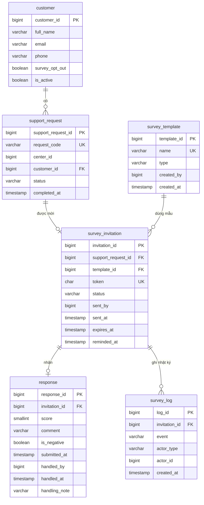

# ERD luồng L8: khảo sát hài lòng CSAT/NPS

ERD có 6 bảng. `customer` và `support_request` thuộc luồng khác nên L8 chỉ đọc (riêng `customer` có thêm cột `survey_opt_out`). Bảng `service_center` không thuộc ERD của L8 (TD-02), nên `support_request.center_id` là cột thường, không có khóa ngoại.

## Sơ đồ quan hệ



## SQL (PostgreSQL 16)

```sql
-- 1. customer (luồng khác, L8 chỉ đọc; thêm survey_opt_out)
CREATE TABLE IF NOT EXISTS customer (
  customer_id    BIGSERIAL PRIMARY KEY,
  full_name      VARCHAR(100) NOT NULL,
  email          VARCHAR(100),
  phone          VARCHAR(15),
  survey_opt_out BOOLEAN NOT NULL DEFAULT false,
  is_active      BOOLEAN NOT NULL DEFAULT true
);

-- 2. support_request (luồng khác, L8 chỉ đọc)
CREATE TABLE IF NOT EXISTS support_request (
  support_request_id BIGSERIAL PRIMARY KEY,
  request_code       VARCHAR(20) UNIQUE NOT NULL,
  center_id          BIGINT NOT NULL, -- mã trung tâm (luồng khác)
  customer_id        BIGINT NOT NULL REFERENCES customer(customer_id),
  status             VARCHAR(20) NOT NULL,
  completed_at       TIMESTAMP
);
CREATE INDEX IF NOT EXISTS idx_request_center_completed
  ON support_request(center_id, completed_at);

-- 3. survey_template (mẫu khảo sát, FR1)
CREATE TABLE IF NOT EXISTS survey_template (
  template_id BIGSERIAL PRIMARY KEY,
  name        VARCHAR(100) NOT NULL UNIQUE,
  type        VARCHAR(4) NOT NULL CHECK (type IN ('CSAT','NPS')),
  created_by  BIGINT NOT NULL, -- mã người dùng Smart CRM (ngoài phạm vi L8)
  created_at  TIMESTAMP NOT NULL DEFAULT now()
);

-- 4. survey_invitation (lời mời khảo sát, mỗi yêu cầu hỗ trợ một lời mời)
CREATE TABLE IF NOT EXISTS survey_invitation (
  invitation_id      BIGSERIAL PRIMARY KEY,
  support_request_id BIGINT NOT NULL UNIQUE REFERENCES support_request(support_request_id),
  template_id        BIGINT NOT NULL REFERENCES survey_template(template_id),
  token              CHAR(32) NOT NULL UNIQUE,
  status             VARCHAR(10) NOT NULL DEFAULT 'SENT'
                     CHECK (status IN ('SENT','ANSWERED','EXPIRED','DECLINED')),
  sent_by            BIGINT NOT NULL,
  sent_at            TIMESTAMP NOT NULL,
  expires_at         TIMESTAMP NOT NULL,
  reminded_at        TIMESTAMP
);
CREATE INDEX IF NOT EXISTS idx_invitation_status
  ON survey_invitation(status, sent_at);

-- 5. response (phản hồi, mỗi lời mời tối đa một phản hồi)
CREATE TABLE IF NOT EXISTS response (
  response_id   BIGSERIAL PRIMARY KEY,
  invitation_id BIGINT NOT NULL UNIQUE REFERENCES survey_invitation(invitation_id),
  score         SMALLINT NOT NULL CHECK (score BETWEEN 0 AND 10),
  comment       VARCHAR(500),
  is_negative   BOOLEAN NOT NULL,
  submitted_at  TIMESTAMP NOT NULL,
  handled_by    BIGINT,
  handled_at    TIMESTAMP,
  handling_note VARCHAR(500)
);
CREATE INDEX IF NOT EXISTS idx_response_submitted
  ON response(submitted_at);

-- 6. survey_log (nhật ký sự kiện của lời mời)
CREATE TABLE IF NOT EXISTS survey_log (
  log_id        BIGSERIAL PRIMARY KEY,
  invitation_id BIGINT NOT NULL REFERENCES survey_invitation(invitation_id),
  event         VARCHAR(30) NOT NULL,
  actor_type    VARCHAR(10) NOT NULL,
  actor_id      BIGINT,
  created_at    TIMESTAMP NOT NULL DEFAULT now()
);
```