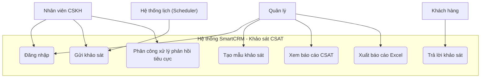

# SRS rút gọn — SmartCRM: Khảo sát hài lòng khách hàng (CSAT)

**Track:** SE | **Stack:** Node.js/Express, React.js, MongoDB

---

## 1. Giới thiệu & Bảng thuật ngữ

**Mục tiêu dự án:** Xây dựng hệ thống cho phép doanh nghiệp tự động gửi khảo sát CSAT đến khách hàng sau khi hỗ trợ/giao dịch, thu thập phản hồi và tạo báo cáo đánh giá chất lượng dịch vụ.

| Thuật ngữ | Ý nghĩa |
|---|---|
| CSAT | Customer Satisfaction Score — điểm hài lòng khách hàng (thang 1–5) |
| Ticket | Yêu cầu hỗ trợ của khách hàng được nhân viên CSKH xử lý |
| Khảo sát | Một phiên khảo sát CSAT được gửi tới một khách hàng cho một ticket cụ thể |
| Token khảo sát | Mã định danh duy nhất, gắn với liên kết khảo sát gửi cho khách hàng |
| Phản hồi tiêu cực | Phản hồi khảo sát có điểm ≤ 2/5 |

---

## 2. Phạm vi hệ thống

**Đối tượng sử dụng (actors):**
- **Khách hàng** — nhận và trả lời khảo sát
- **Nhân viên CSKH** — gửi khảo sát, xử lý phản hồi tiêu cực
- **Quản lý** — xem báo cáo, quản lý mẫu khảo sát
- **Hệ thống lịch (Scheduler)** — actor hệ thống, tự động kích hoạt gửi khảo sát khi ticket đóng

**Trong phạm vi:** gửi khảo sát tự động, thu thập phản hồi, báo cáo CSAT, quản lý mẫu câu hỏi, phân quyền người dùng, cảnh báo phản hồi tiêu cực.

**Ngoài phạm vi:** tích hợp tổng đài thoại, phân tích cảm xúc bằng AI, ứng dụng di động riêng.

---

## 3. User Stories

| # | User Story | MoSCoW |
|---|---|---|
| US1 | Là **khách hàng**, tôi muốn **trả lời khảo sát CSAT ngay sau khi được hỗ trợ**, để tôi **có thể góp ý nhanh về trải nghiệm dịch vụ**. | MUST |
| US2 | Là **nhân viên CSKH**, tôi muốn **hệ thống tự động gửi khảo sát khi ticket được đóng**, để **không bỏ sót khách hàng cần khảo sát**. | MUST |
| US3 | Là **quản lý**, tôi muốn **xem báo cáo điểm CSAT trung bình theo ngày/tuần**, để **đánh giá chất lượng dịch vụ của đội CSKH**. | SHOULD |
| US4 | Là **quản lý**, tôi muốn **tạo và chỉnh sửa mẫu câu hỏi khảo sát**, để **phù hợp với từng loại dịch vụ**. | SHOULD |
| US5 | Là **nhân viên CSKH**, tôi muốn **nhận thông báo khi có phản hồi điểm thấp (≤2 sao)**, để **xử lý khách hàng không hài lòng kịp thời**. | SHOULD |
| US6 | Là **quản lý**, tôi muốn **xuất báo cáo CSAT ra file Excel**, để **trình bày trong cuộc họp**. | COULD |
| US7 | Là **nhân viên CSKH/quản lý**, tôi muốn **đăng nhập bằng tài khoản cá nhân**, để **hệ thống phân quyền đúng chức năng tôi được dùng**. | MUST |
| US8 | Là **khách hàng**, tôi muốn **nhận liên kết khảo sát qua email/SMS**, để **có thể trả lời trên điện thoại hoặc máy tính dễ dàng**. | COULD |

### Tiêu chí chấp nhận (Given–When–Then) — đủ cho cả 8 story

**US1 — Trả lời khảo sát (MUST)**
- AC1 (chính): Given liên kết khảo sát hợp lệ, When khách hàng chọn điểm (1–5) và nhấn Gửi, Then hệ thống lưu phản hồi và hiển thị lời cảm ơn.
- AC2 (ngoại lệ — hết hạn): Given liên kết đã quá 7 ngày kể từ khi gửi, When khách hàng mở liên kết, Then hệ thống hiển thị "Khảo sát đã hết hạn" và không cho gửi điểm.
- AC3 (ngoại lệ — đã trả lời): Given khách hàng đã gửi phản hồi trước đó, When khách hàng mở lại liên kết, Then hệ thống hiển thị phản hồi cũ ở chế độ chỉ xem.

**US2 — Gửi khảo sát tự động (MUST)**
- AC1 (chính): Given một ticket chuyển trạng thái "Đã đóng", When hệ thống xử lý sự kiện đóng ticket, Then hệ thống tạo khảo sát và gửi email/SMS chứa liên kết trong vòng 5 phút.
- AC2 (ngoại lệ): Given khách hàng không có email/SĐT hợp lệ, When hệ thống cố gửi khảo sát, Then hệ thống ghi log lỗi và đánh dấu trạng thái "Không gửi được".

**US3 — Xem báo cáo CSAT (SHOULD)**
- AC1 (chính): Given có ít nhất 1 phản hồi khảo sát trong khoảng thời gian chọn, When quản lý chọn khoảng ngày và nhấn "Xem báo cáo", Then hệ thống hiển thị điểm CSAT trung bình và biểu đồ theo ngày/tuần.
- AC2 (ngoại lệ): Given không có phản hồi nào trong khoảng thời gian chọn, When quản lý xem báo cáo, Then hệ thống hiển thị "Không có dữ liệu" thay vì biểu đồ trống.

**US4 — Tạo mẫu khảo sát (SHOULD)**
- AC1 (chính): Given quản lý nhập đầy đủ tên mẫu và ít nhất 1 câu hỏi, When nhấn "Lưu mẫu", Then hệ thống lưu mẫu và hiển thị trong danh sách mẫu khảo sát.
- AC2 (ngoại lệ): Given tên mẫu bị bỏ trống, When nhấn "Lưu mẫu", Then hệ thống hiển thị lỗi "Vui lòng nhập tên mẫu" và không lưu.

**US5 — Thông báo phản hồi tiêu cực (SHOULD)**
- AC1 (chính): Given một phản hồi khảo sát có điểm ≤ 2, When hệ thống nhận phản hồi, Then hệ thống gửi thông báo trong ứng dụng cho nhân viên CSKH phụ trách ticket đó trong vòng 1 phút.
- AC2 (ngoại lệ): Given ticket không còn nhân viên phụ trách, When hệ thống gửi thông báo, Then hệ thống chuyển thông báo đến quản lý thay thế.

**US6 — Xuất báo cáo Excel (COULD)**
- AC1 (chính): Given báo cáo CSAT đã hiển thị trên màn hình, When quản lý nhấn "Xuất Excel", Then hệ thống tạo file .xlsx chứa đúng dữ liệu đang hiển thị và tải về.
- AC2 (ngoại lệ): Given dữ liệu báo cáo rỗng, When quản lý nhấn "Xuất Excel", Then hệ thống hiển thị cảnh báo "Không có dữ liệu để xuất" và không tạo file.

**US7 — Đăng nhập & phân quyền (MUST)**
- AC1 (chính): Given tài khoản và mật khẩu đúng, When người dùng đăng nhập, Then hệ thống cấp token và chuyển đến trang chủ theo đúng vai trò.
- AC2 (ngoại lệ): Given người dùng nhập sai mật khẩu 5 lần liên tiếp, When thử đăng nhập lần thứ 6, Then hệ thống khóa tài khoản tạm thời 15 phút.

**US8 — Gửi liên kết qua email/SMS (COULD)**
- AC1 (chính): Given khách hàng có email hợp lệ, When hệ thống gửi khảo sát, Then khách hàng nhận được email chứa liên kết trong vòng 5 phút.
- AC2 (ngoại lệ): Given gửi email thất bại (bounce), When hệ thống phát hiện lỗi gửi, Then hệ thống tự động thử gửi lại qua SMS nếu có số điện thoại.

---

## 4. Use Case Diagram & Đặc tả chi tiết

> Lưu ý: sơ đồ trên dùng để tham khảo nhanh. Bài nộp chính thức dùng file `use-case-diagram-csat.drawio` (đã tạo sẵn) lưu trong `docs/diagrams/`.

**Đặc tả chi tiết: Use Case "Trả lời khảo sát" (quan trọng nhất)**

- **Actor chính:** Khách hàng
- **Điều kiện trước:** Khảo sát đã được tạo và gửi; liên kết còn hiệu lực.
- **Điều kiện sau:** Phản hồi được lưu; trạng thái khảo sát chuyển thành "Đã trả lời".

**Luồng chính:**
1. Khách hàng nhấn vào liên kết khảo sát nhận qua email/SMS.
2. Hệ thống kiểm tra tính hợp lệ của liên kết (token, hạn sử dụng).
3. Hệ thống hiển thị form khảo sát (thang điểm 1–5, ô nhận xét tùy chọn).
4. Khách hàng chọn mức điểm, nhập nhận xét (nếu có).
5. Khách hàng nhấn "Gửi".
6. Hệ thống xác thực dữ liệu đầu vào.
7. Hệ thống lưu phản hồi, cập nhật trạng thái khảo sát.
8. Hệ thống hiển thị trang cảm ơn.

**Luồng ngoại lệ:**
- **3a** (từ bước 2): Liên kết đã hết hạn (>7 ngày) → hệ thống hiển thị "Khảo sát đã hết hạn", kết thúc use case.
- **3b** (từ bước 2): Khảo sát đã được trả lời trước đó → hệ thống hiển thị phản hồi cũ ở chế độ chỉ xem, kết thúc use case.
- **6a** (từ bước 6): Khách hàng không chọn mức điểm → hệ thống hiển thị lỗi "Vui lòng chọn mức độ hài lòng", quay lại bước 4.

---

## 5. Yêu cầu phi chức năng (NFR)

| Mã | Yêu cầu | Ngưỡng số |
|---|---|---|
| NFR01 | Thời gian phản hồi API | < 500ms cho 95% request |
| NFR02 | Độ trễ gửi khảo sát sau khi đóng ticket | ≤ 5 phút |
| NFR03 | Độ sẵn sàng hệ thống trong giờ hành chính | ≥ 99% uptime |
| NFR04 | Mã hóa mật khẩu người dùng | bcrypt, cost factor ≥ 10 |

---

## 6. Bảng truy vết (FR ↔ US ↔ Use Case ↔ MoSCoW)

| FR | Mô tả | User Story | Use Case | MoSCoW |
|---|---|---|---|---|
| FR01 | Tự động gửi khảo sát khi đóng ticket | US2 | Gửi khảo sát | MUST |
| FR02 | Khách hàng gửi phản hồi khảo sát | US1 | Trả lời khảo sát | MUST |
| FR03 | Đăng nhập và phân quyền | US7 | Đăng nhập | MUST |
| FR04 | Xem báo cáo CSAT trung bình | US3 | Xem báo cáo CSAT | SHOULD |
| FR05 | Tạo/sửa mẫu câu hỏi khảo sát | US4 | Tạo mẫu khảo sát | SHOULD |
| FR06 | Thông báo phản hồi tiêu cực | US5 | Phân công xử lý phản hồi tiêu cực | SHOULD |
| FR07 | Xuất báo cáo CSAT ra Excel | US6 | Xuất báo cáo Excel | COULD |
| FR08 | Gửi liên kết khảo sát qua email/SMS | US8 | Gửi khảo sát | COULD |
